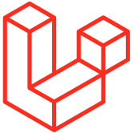

<p align="center">
  
</p>

<h1 align="center">✨ KelolaUang AI</h1>

<p align="center">
  <strong>Platform Manajemen Keuangan Pribadi Cerdas Berbasis AI</strong><br>
  Catat pengeluaran hanya dengan mengetik bahasa sehari-hari, pantau arus kas secara visual, dan dapatkan konsultasi finansial pribadi dari <em>Google Gemini AI</em>.
</p>

<p align="center">
  
  
  
  
  
  
</p>

---

## 🌟 Sorotan Fitur Utama

### 🧠 1. Smart AI Transaction Parser (Google Gemini)
- Tidak perlu lagi repot memilih dropdown kategori dan form yang rumit!
- Cukup ketik teks bebas Bahasa Indonesia sehari-hari:
  > *"Beli ayam geprek 18rb pakai QRIS"*  
  > *"Bayar kos bulan ini 650k transfer"*  
  > *"Dapat uang saku tambahan 500rb"*
- AI secara instan mengekstrak **nominal**, **tipe (pemasukan/pengeluaran)**, **kategori yang cocok**, **metode pembayaran**, dan **tanggal**, lalu otomatis menyimpannya ke database.

### 💡 2. AI Personal Financial Advisor
- Dapatkan evaluasi performa finansial bulan berjalan hanya dengan satu klik tombol **"Analisis Keuangan Bulan Ini"**.
- AI menganalisis rasio tabungan, defisit/surplus arus kas, dan 3 pengeluaran terbesar untuk memberikan 3–4 rekomendasi berhemat yang konkret, ramah, dan aplikatif.

### 📊 3. Visual Dashboard & Manajemen Anggaran Cerdas
- **4 Kartu Metrik Utama:** Total Saldo Akumulasi, Pemasukan Bulan Ini, Pengeluaran Bulan Ini, dan Sisa Anggaran Aman.
- **Budgeting Interaktif:** Tetapkan batas maksimal pengeluaran per kategori. Dilengkapi visual progress bar adaptif:
  - 🟢 **Normal (< 80%)**: Warna Pink Primary
  - 🟡 **Peringatan (80% - 100%)**: Warna Amber/Kuning
  - 🔴 **Over-budget (> 100%)**: Warna Rose/Merah dengan notifikasi peringatan
- **Grafik & Distribusi:** Lihat persentase pengeluaran kategori terbesar.

### 🎨 4. Modern Dark Mode Glassmorphism & Responsif
- Dirancang khusus dengan palet gelap modern:
  - **Background:** Deep Dark Slate/Navy (`#090d16`)
  - **Aksen Utama:** Pink Glow (`#ec4899`)
  - **Glassmorphism:** Kartu semi-transparan dengan `backdrop-blur-md`
- **Mobile First & PWA:**
  - Dilengkapi *Fixed Bottom Navigation Bar* untuk navigasi satu jempol di layar HP.
  - Tombol tengah menonjol **Catat AI** (Floating Pink Button).
  - Siap di-install langsung ke homescreen Android, iOS, maupun Desktop (Progressive Web App).

---

## 🛠️ Stack Teknologi

| Layer | Teknologi |
| :--- | :--- |
| **Backend Framework** | Laravel 12 (PHP 8.2 / 8.3+) |
| **Frontend Framework** | Vue 3 (Composition API + `<script setup lang="ts">`) |
| **Fullstack Glue** | Inertia.js v3 |
| **Styling & Theme** | Tailwind CSS v4, Lucide Icons (`@lucide/vue`) |
| **Artificial Intelligence** | Google Gemini API (`gemini-3.1-flash`) |
| **Database** | MySQL / SQLite |
| **Mobile Integration** | Progressive Web App (PWA) Manifest & Service Worker |

---

## 🚀 Panduan Instalasi Cepat

### 1. Clone Repositori
```bash
git clone https://github.com/username/kelolauang-ai.git
cd kelolauang-ai
```

### 2. Pasang Dependensi PHP & Node.js
```bash
composer install
npm install
```

### 3. Konfigurasi Environment (`.env`)
Salin file `.env.example` ke `.env`:
```bash
cp .env.example .env
```
Generate application key:
```bash
php artisan key:generate
```

### 4. Atur Database & Google Gemini API Key
Buka file `.env` dan sesuaikan koneksi database serta API Key Gemini:
```env
DB_CONNECTION=mysql
DB_HOST=127.0.0.1
DB_PORT=3306
DB_DATABASE=kelolauangg
DB_USERNAME=root
DB_PASSWORD=

# Google Gemini API Key (Dapatkan gratis di https://aistudio.google.com/)
GEMINI_API_KEY=AIzaSyDxxxxxxxxxxxxxxxxxxxxxxxxxxxxxxx
GEMINI_MODEL=gemini-3.1-flash
```

### 5. Migrasi Database & Seeder
Buat tabel dan isi kategori standar sistem (Gaji, Makan & Minum, Kos, Transportasi, dll.):
```bash
php artisan migrate --seed
```

### 6. Jalankan Server Pengembangan
Buka dua terminal terpisah:

**Terminal 1 (Vite Frontend):**
```bash
npm run dev
```

**Terminal 2 (Laravel Server):**
```bash
php artisan serve
```

Aplikasi sekarang dapat diakses melalui browser di: `http://localhost:8000` atau domain lokal Anda (cth: `http://kelolauang-ai.test`).

---

## 📱 Tampilan Antarmuka

| Tampilan Desktop | Tampilan Mobile |
| :---: | :---: |
| Dashboard modern dengan Sidebar tetap & panel analitik luas | Bottom Navigation Bar + Tombol Mengambang *Catat AI* |

---

## 📂 Struktur Modul Penting

```plaintext
kelolauang-ai/
├── app/
│   ├── Http/Controllers/
│   │   ├── DashboardController.php      # Ringkasan saldo, chart, & 10 transaksi
│   │   ├── TransactionController.php    # CRUD transaksi & filter pencarian
│   │   ├── BudgetController.php         # Manajemen limit anggaran per kategori
│   │   └── AiFinanceController.php      # Controller integrasi parser & advisor AI
│   ├── Models/
│   │   ├── Category.php                 # Model kategori income / expense
│   │   ├── Transaction.php              # Model transaksi keuangan
│   │   └── Budget.php                   # Model limit anggaran bulanan
│   └── Services/
│       └── GeminiFinanceService.php     # Service call ke REST API Google Gemini
├── resources/
│   └── js/
│       ├── layouts/
│       │   └── AppLayout.vue            # Layout responsive (Sidebar + Bottom Nav HP)
│       └── pages/
│           ├── Dashboard.vue            # Halaman utama, Quick AI & Financial Advisor
│           ├── Transactions/Index.vue   # Filter, tabel & modal transaksi
│           └── Budgets/Index.vue        # Manajemen alokasi anggaran bulanan
└── public/
    └── manifest.json                    # Konfigurasi PWA Installable
```

---

## 📄 Lisensi
Proyek ini dibuat untuk keperluan manajemen finansial pribadi cerdas dan dilisensikan di bawah [MIT License](LICENSE).
